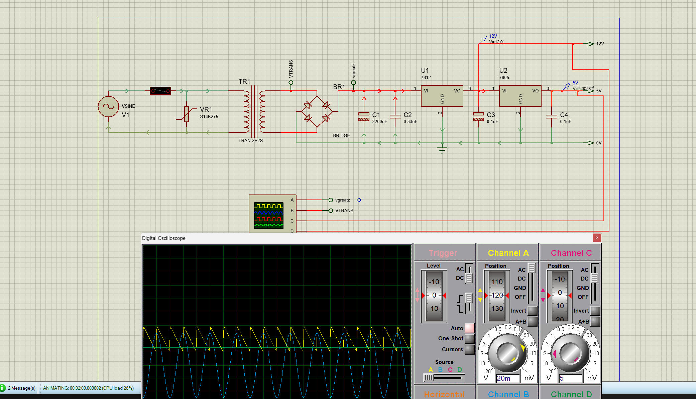
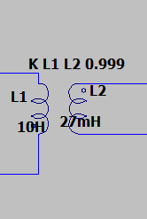
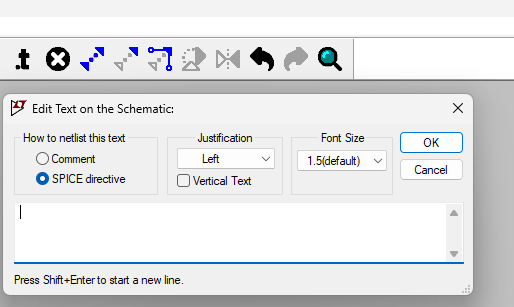
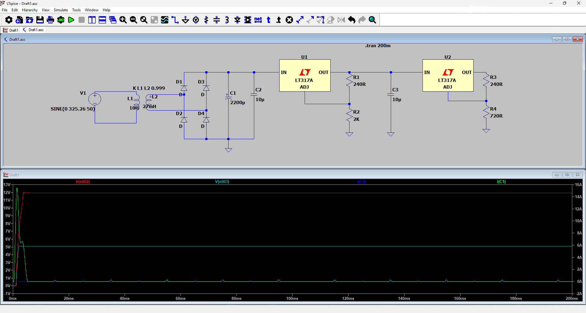

# Linear AC-DC Power Supply Simulation



Simulation project for a linear mains-powered AC-DC power supply designed to convert an AC input into regulated **12 V DC** and **5 V DC** output rails.

The project documents the power-conversion chain through LTspice and Proteus simulations, including transformer-based voltage reduction, rectification, filtering and regulation stages.

> **Safety notice:** This repository documents an educational simulation project.  
> Do not connect a circuit to 230 VAC mains without suitable isolation, fusing, protective enclosure, grounding strategy, creepage/clearance verification and supervision by a qualified person.

---

## Project overview

The purpose of this project is to study and simulate a conventional linear power supply capable of generating two DC rails for low-voltage electronics:

```text
AC input
   ↓
Step-down transformer
   ↓
Bridge rectifier
   ↓
Smoothing / filtering capacitors
   ↓
Voltage regulation
   ├── Regulated 12 V DC output
   └── Regulated 5 V DC output
```

Typical applications include educational electronics projects, low-power embedded systems, sensor interfaces and compact automation or PLC-related prototypes.

---

## Conversion stages

| Stage | Function |
|---|---|
| AC input | Represents the mains-side AC source in the simulation |
| Transformer | Reduces the AC voltage to a safer low-voltage level |
| Rectifier | Converts the transformer secondary AC waveform to pulsating DC |
| Filter | Reduces ripple using smoothing capacitors |
| 12 V regulator | Produces a regulated 12 V DC rail |
| 5 V regulator | Produces a regulated 5 V DC rail |
| Simulation probes | Observe voltages and validate behavior in LTspice and Proteus |

---

## Transformer stage

The transformer provides galvanic isolation in a real physical design and reduces the AC input voltage before the rectification stage.





> The transformer illustration and simulation context are educational. Real transformer selection requires voltage, current, thermal, insulation and safety-margin calculations for the intended load.

---

## LTspice simulation

The LTspice schematic is available at:

```text
simulation/LTspice/220V to 12 à 5V.asc
```

Open the `.asc` file with LTspice to inspect the complete simulation schematic, component values and waveforms.



The simulation can be used to observe:

- AC voltage reduction through the transformer stage.
- Rectified waveform after the bridge rectifier.
- Capacitor filtering behavior.
- Output-voltage stabilization.
- Ripple and transient behavior, depending on the configured loads and component values.

---

## Proteus validation

The Proteus project file is available at:

```text
hardware/schematic/220V to 12 à 5V.pdsprj
```


Use Proteus to open the project, inspect the schematic and validate the simulated output rails.

> Depending on the Proteus version and project settings, companion files may be required for a fully reproducible simulation. Keep files generated by Proteus in the same local working directory when opening the project.

---

## Repository structure

```text
.
├── assets/
│   ├── images/
│   │   ├── directive_transformer.png
│   │   ├── transformer.png
│   │   └── visualization_ltspice.png
│   └── screenshots/
│       └── proteus_validation.png
│
├── hardware/
│   └── schematic/
│       └── 220V to 12 à 5V.pdsprj
│
├── simulation/
│   └── LTspice/
│       └── 220V to 12 à 5V.asc
│
├── .gitignore
└── README.md
```

---

## How to use

### LTspice

1. Install LTspice.
2. Open:

   ```text
   simulation/LTspice/220V to 12 à 5V.asc
   ```

3. Run the simulation.
4. Probe the AC, rectified, filtered, 12 V and 5 V nodes.
5. Compare the behavior before and after filtering and regulation.

### Proteus

1. Install Proteus.
2. Open:

   ```text
   hardware/schematic/220V to 12 à 5V.pdsprj
   ```

3. Inspect the schematic and simulation settings.
4. Run the simulation.
5. Validate the 12 V and 5 V output rails.

---

## Engineering considerations

A real linear AC-DC supply design must account for more than output voltage. Important considerations include:

- Transformer secondary RMS voltage and power rating.
- Rectifier diode current and reverse-voltage ratings.
- Filter-capacitor voltage rating and ripple-current capability.
- Load current and output ripple.
- Regulator dropout voltage.
- Regulator power dissipation and heatsinking.
- Inrush current at power-up.
- Fuse selection.
- Surge protection.
- PCB creepage and clearance distances.
- Enclosure, grounding and isolation strategy.
- Applicable electrical-safety requirements.

For a capacitor-input rectifier, an approximate ripple-voltage relationship is:

$$
\Delta V \approx \frac{I_{load}}{f_{ripple} \cdot C}
$$

For a full-wave rectifier supplied by a 50 Hz mains source:

$$
f_{ripple} = 2 \times 50 = 100\ \text{Hz}
$$

This relation is only an initial approximation; practical behavior depends on transformer regulation, diode drops, capacitor ESR, load dynamics and regulator characteristics.

---

## Limitations

- This repository documents simulations, not a certified physical power supply.
- The exact regulator models, loads and component values must be checked directly in the LTspice and Proteus project files.
- Simulation results do not replace electrical-safety validation.
- The project should not be connected to live mains without a reviewed and properly protected hardware design.

---

## Possible improvements

- Add a bill of materials with ratings and manufacturer references.
- Add input fuse and surge-protection circuits.
- Add measured or simulated ripple plots for each stage.
- Add load-step transient simulations.
- Add thermal calculations for the regulators.
- Add a PCB design with proper mains isolation rules.
- Add transformer sizing calculations.
- Compare linear regulation with a switching power-supply alternative.
- Add a 3D enclosure concept.

---

## Software

- LTspice
- Proteus

---

## Author

**Joseph Mbode**

Embedded systems, electronics, power electronics and mechatronics projects.

- GitHub: [@Josephulrich](https://github.com/Josephulrich)
- LinkedIn: [Joseph Mbode](https://www.linkedin.com/in/joseph-mbode)
